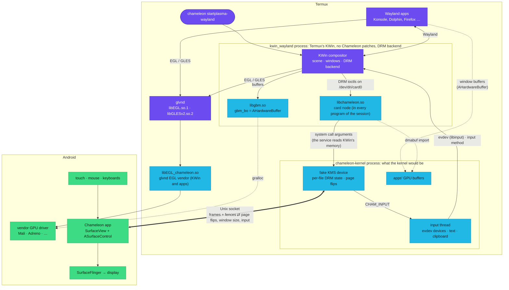
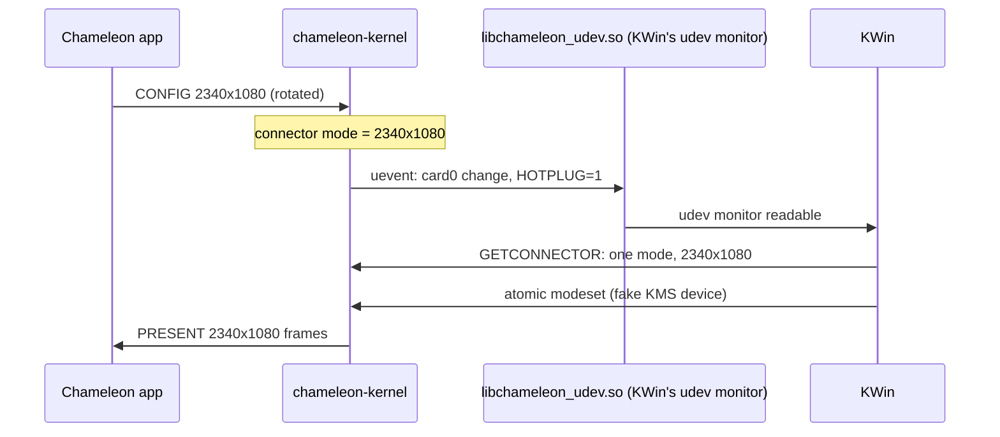
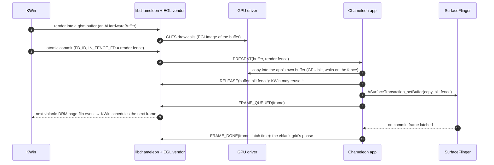
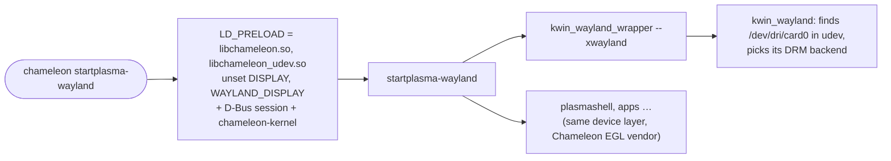

<p align="center">
  
</p>

<h1 align="center">Project Chameleon</h1>

<p align="center">
  <b>Experimental display for Termux Wayland compositors, aiming to be universal.</b><br>
  The Android app is the compositor's screen, drawn by the phone's own GPU · works with KWin, including full Plasma · <code>AHardwareBuffer</code>s, no CPU copies · no root
</p>

<p align="center">
  <a href="https://github.com/HarryL0L/Project-Chameleon/actions/workflows/build.yml"></a>
</p>

---

Chameleon gives Linux graphics software in Termux what it expects from a PC
with a real graphics card, backed by Android: a display, GPU buffers and a GPU
driver. The first target is the Termux build of **KWin**, with a whole
Plasma session on top of it:

- KWin runs with its normal **DRM backend**, not nested inside another
  compositor, and with no Chameleon-specific patches.
- Rendering goes through Android's **vendor GPU driver** (Mali, Adreno, …)
  via EGL/GLES. It doesn't use a software rasteriser.
- Finished frames travel to an Android app as **`AHardwareBuffer`s plus
  fences**. The pixels are never copied through the CPU.
- Touch (as a touchscreen or a trackpad), mouse, hardware keyboards and the
  Android on-screen keyboard are fed back into KWin. Shortcuts Android keeps
  for itself, like Alt+Tab and Meta, need the app's optional accessibility
  service.

It works by giving KWin the few things it expects from a Linux PC, a KMS
display device, GBM buffers and an EGL driver, all backed by Android APIs.
The same pieces are meant to carry other Wayland compositors and apps later;
the EGL driver already renders Wayland apps on the GPU.

## How it works

> The diagrams are interactive on GitHub: use the controls in the corner of
> each one to zoom, pan or open it full screen.



Purple is KDE/Termux software as shipped, blue is Chameleon's shim, and green
is Android. The card, the input devices and the link to the app live in
`chameleon-kernel`, which `chameleon` starts for the session, as the kernel
would serve them; KWin reaches the card through its device node. The service
and the app talk over one Unix socket: it connects to
`$PREFIX/tmp/chameleon-0`, where a small broker from the app's APK, running in
Termux, hands the connection to the app.

<details>
<summary><b>🦎 The Chameleon app</b>: Android side, shows frames and collects input</summary>

- A full-screen `SurfaceView` whose `ASurfaceControl` receives KWin's buffers
  with `ASurfaceTransaction_setBuffer`, together with KWin's acquire fence.
- It reports the surface size and the display's current refresh rate to KWin
  (`CONFIG`). KWin sees them as the mode of a DSI connector, and the screen
  follows the window when it rotates or resizes (see *Screen size* below).
  Settings choose the orientation (rotate with the phone, portrait or
  landscape) and whether the keyboard shrinks the desktop or covers it.
- **Page flips:** they complete like on a real display engine (and like
  VKMS): on the first vblank after the commit, with the vblanks following
  SurfaceFlinger's latch times. The app copies the frame meanwhile
  (`FRAME_QUEUED`) and reports each latch (`FRAME_DONE`). A flip also waits
  until the previous copy is done and Android has latched what it should
  have by then. On Android 12+ (back pressure, so Android drops no frame)
  up to two frames may wait in Android: KWin aims its commit at the vblank,
  while Android wants the buffer a few ms before its own latch, and the
  second frame covers that gap. Before Android 12, one.
- **Back from the background:** Android destroys the surface while the app
  is hidden. The app keeps its copy of the last frame and shows it again on
  the new surface, since KWin only draws when something changes.
- **Input:** touches are sent as direct touch or trackpad gestures (your
  choice in settings). Mouse and hardware keys are forwarded, and the
  on-screen keyboard comes with an extra row (Esc, Tab, sticky Ctrl/Alt,
  arrows, Home/End, PgUp/PgDn).
- **Works with any Termux:** the app is an ordinary app, so it installs next
  to Termux from GitHub or F-Droid. It can't open files in Termux, so the
  `chameleon` launcher starts a small broker from the app's own APK
  (`app_process`, as the Termux user). The broker listens on
  `$PREFIX/tmp/chameleon-0` and passes each connection from KWin to the app
  over Binder; the app accepts them only from Termux's user.

Code: [`android/`](android/) · protocol: [`common/chameleon_proto.h`](common/chameleon_proto.h)
</details>

<details>
<summary><b>🖥️ chameleon-kernel</b>: a fake KMS display device</summary>

- A process `chameleon` starts before the session, like the kernel under
  any program. `libchameleon.so`, preloaded into every program of the
  session, makes `/dev/dri/card0` (compositors find it in udev, like any
  GPU) a device node:
  opening it returns a pipe that behaves like a DRM card, `stat()` says it's
  a character device, and each DRM `ioctl` goes to the service as the system
  call's arguments. The service reads and writes the caller's memory itself,
  as the kernel does, and keeps each open file's state (DRM master, client
  caps, GEM handles), released when the file's last copy closes, even in a
  process that died.
- It offers one connector (with an EDID: "Chameleon", the phone's physical
  size, the app's size and refresh rate as its preferred mode), one CRTC
  and one primary plane, with atomic
  modesetting, `TEST_ONLY` commits, `EBUSY` while a flip is pending, and
  page-flip events written to the pipe.
- An atomic commit sends a `PRESENT` to the app with the framebuffer's
  `AHardwareBuffer` and KWin's render fence (`IN_FENCE_FD`). If the app is closed, a simulated
  vblank keeps KWin running.
- It also runs the input devices, the input thread and the registry of
  apps' GPU buffers, so a KWin that dies takes none of them along.
  `libchameleon.so` keeps a crash reporter in programs that render with
  Android's driver, which logs the last GL/EGL calls and a symbolised
  backtrace.

Code: [`shim/core/`](shim/core/)
</details>

<details>
<summary><b>🧱 libgbm.so</b>: GBM buffers are AHardwareBuffers</summary>

- A complete `libgbm` API: every `gbm_bo` is an `AHardwareBuffer` allocated
  through gralloc.
- A buffer's dmabuf fd is the gralloc handle's own dmabuf, so KWin's usual
  path (gbm → PRIME fd → `DRM_IOCTL_MODE_ADDFB2` → EGL import) works
  unchanged.

Code: [`shim/gbm/`](shim/gbm/)
</details>

<details>
<summary><b>🎨 libEGL_chameleon.so</b>: a glvnd EGL vendor for Android's GPU driver</summary>

- Termux programs link glvnd's `libEGL.so.1` / `libGLESv2.so.2`, which load
  *vendor* libraries. Chameleon is one: glvnd asks it for displays and for
  every EGL and GL entry point, and it hands out Android's
  `libEGL.so` / `libGLESv2.so`, i.e. the vendor driver.
- **In a Chameleon session**, it adds what a Mesa GBM stack provides: the GBM platform,
  and `EGL_EXT_image_dma_buf_import`, which imports a Chameleon buffer as its
  `AHardwareBuffer` through `EGL_NATIVE_BUFFER_ANDROID`.
- **Driver workarounds:** it rewrites GLSL `#if GL_ext` to
  `#if defined(GL_ext)` (Mesa tolerates the bare form; strict drivers don't).
  It can also hide extensions and drop context attributes that a driver
  mishandles.
- **Wayland apps on the GPU:** under a Chameleon KWin it also takes
  `EGL_PLATFORM_WAYLAND_KHR`. Each `wl_egl_window` renders into an
  `AImageReader`, a real Android window surface, so the driver's buffer
  handling works as usual; a resize asks that window for buffers of the
  new size, as a `SurfaceView` resizes. Every frame then reaches KWin as an
  `AHardwareBuffer`: it is registered with `chameleon-kernel`, wrapped in a
  `zwp_linux_dmabuf_v1` buffer and committed on the app's surface. Nothing
  is copied, and frame callbacks pace the app.
- **Qt without a rebuild:** Android's driver speaks OpenGL ES only, while
  Termux's Qt is built for desktop OpenGL. Qt already switches to OpenGL ES
  on EGL implementations without desktop GL, as it does for NVIDIA's. So in
  Qt apps on its Wayland platform, the vendor reports an EGL vendor string
  that triggers that path, and stock Qt Quick apps (plasmashell, System
  Settings…) render on the GPU. `CHAMELEON_EGL_QT=mesa` leaves them to Mesa.
- **Scope:** apps that need desktop OpenGL itself, X11 windows, and Wayland
  windows under any other compositor still go to Mesa.

Code: [`shim/vendor/`](shim/vendor/), [`shim/egl/`](shim/egl/), [`shim/gles/`](shim/gles/)
</details>

<details>
<summary><b>⌨️ Input</b>: from Android touch to KWin</summary>

- The app sends `CHAM_INPUT` messages over the same socket: touch points,
  trackpad fingers, mouse motion, buttons and wheels, hardware keys by Linux
  key code, and the Android keyboard's text. Positions are fractions of the
  surface.
- The shim serves them as evdev devices (touchscreen, keyboard, mouse,
  touchpad, tablet), which `libchameleon_udev.so` shows through udev and
  `/dev/input/eventN`. KWin's libinput reads them like real hardware, so
  KDE's input settings apply.
- The Android keyboard's text goes to `chameleon-ime`, the desktop's on-screen
  keyboard (input method), whenever the focused app has a text field:
  suggestions, the word being composed, emoji, any language. Elsewhere (X11
  apps) it is typed as keys of the desktop's layout, like on a hardware
  keyboard. The package makes it KWin's default (`$PREFIX/etc/xdg/kwinrc`);
  System Settings > Keyboard > Virtual Keyboard lists it as "Chameleon
  (Android keyboard)" and can choose another one or none. Weston takes it
  from `weston.ini`:
  `[input-method]` `path=/data/data/com.termux/files/usr/lib/chameleon/chameleon-ime`.

Code: [`shim/core/input.c`](shim/core/input.c), [`shim/core/evdev.c`](shim/core/evdev.c), [`shim/ime/ime.c`](shim/ime/ime.c), [`android/…/TouchInput.java`](android/app/src/main/java/io/github/harryl0l/chameleon/TouchInput.java), [`KeyInput.java`](android/app/src/main/java/io/github/harryl0l/chameleon/KeyInput.java)
</details>

<details>
<summary><b>🔄 Screen size</b>: rotation and the keyboard resize the desktop</summary>

- Rotating the phone, or opening the keyboard with *Shrink the desktop above
  the keyboard* on, changes the app's surface size, and the app sends a new
  `CONFIG`.
- The fake display behaves like a monitor whose modes changed: the
  connector's one mode becomes the window's size and the display's refresh
  rate, and the card sends a hotplug uevent (`HOTPLUG=1`) to udev monitors.
- KWin re-reads the connector, as it does when a monitor is plugged in or
  its modes change, finds its mode gone and switches to the new one, then
  lays out panels and windows for the new screen. Nothing here talks to
  KWin directly.
- The refresh rate is followed the same way: when battery saver drops the
  display from 120 Hz to 60 Hz (or back), the mode changes with it.
- The EDID stays the one of the first size, so KWin keeps seeing the same
  monitor (its scale and settings stay). Until KWin has switched, the app
  scales the frame to fit and keeps its aspect ratio.
  `CHAMELEON_RESIZE=0` keeps KWin's screen at its first size.



Code: [`shim/core/kms.c`](shim/core/kms.c), [`shim/udev/udev.c`](shim/udev/udev.c), [`presenter.cpp`](android/app/src/main/cpp/presenter.cpp) (`place()`)
</details>

<details>
<summary><b>📋 Clipboard</b>: copy on one side, paste on the other</summary>

- Text copied in a desktop app can be pasted in Android apps, and the other
  way round (*Clipboard sharing* in the app's settings, on by default).
- On the same Wayland connection as input, the shim joins KWin's clipboard
  the way a clipboard manager does, with `ext_data_control_v1` (KWin 6.4 and
  later). X11 apps share it through Xwayland as usual.
- The text itself only travels through pipes, never through the shim: a
  desktop copy is written by the copying app into a pipe whose other end
  goes to the Chameleon app (`CLIPBOARD_DATA`), and a desktop paste of
  Android's text gets a pipe the Chameleon app writes into
  (`CLIPBOARD_REQUEST`).
- Android lets only the app in front read its clipboard, so new Android text
  is offered (`CLIPBOARD_OFFER`) when Chameleon gets the focus or while it
  has it. The clip itself is only read when it changed, so Android doesn't
  keep showing "pasted from your clipboard". Desktop text reaches Android at
  any time.
- Only text is shared; Android images and files stay on Android.
- Passwords stay hidden both ways: a desktop password manager's copy
  (marked with `x-kde-passwordManagerHint`, e.g. KeePassXC) is marked
  sensitive on Android, which hides it in its "copied" preview, and text
  Android apps mark sensitive gets that hint on the desktop, which keeps it
  out of Klipper's history.

Code: [`shim/core/clipboard.c`](shim/core/clipboard.c), [`ClipboardShare.java`](android/app/src/main/java/io/github/harryl0l/chameleon/ClipboardShare.java)
</details>

### One frame, end to end



### Launch flow



Every program in the session sees the same device layer, so nothing picks
out KWin, and the same works for `chameleon weston` or `chameleon sway`.
Nothing in plasma-workspace changes, and you never pass `--drm` yourself:
with neither `WAYLAND_DISPLAY` nor `DISPLAY` set, a compositor picks its
DRM backend.

## What a phone needs

Chameleon uses only public Android APIs and the phone's own GPU driver
(through `/system/lib64/libEGL.so` / `libGLESv2.so`); no root, no access to
`/dev/dri`, no Vulkan and no desktop OpenGL. What the driver must offer:

**System**

| | Needed for |
|---|---|
| arm64 (aarch64), **Android 10** (API 29) or newer | the app (`ASurfaceControl`) and Termux |
| Termux from [GitHub](https://github.com/termux/termux-app/releases) or [F-Droid](https://f-droid.org/packages/com.termux/) | KWin, Plasma and the shim run in it |
| `AHardwareBuffer` (API 26) that can be allocated as RGBA8888 / RGBX8888 with `GPU_SAMPLED_IMAGE \| GPU_COLOR_OUTPUT`, and sent over a Unix socket | every frame: KWin's output and app buffers |
| a dmabuf inside the gralloc handle (`AHardwareBuffer_getNativeHandle`) | buffers are matched across processes by it |
| `AImageReader` from `libmediandk` (API 26) | GPU rendering for Wayland apps; without it apps fall back to Mesa |
| Android sync fences (sync_file) | acquire/release fences between KWin, apps and the app |

**EGL** (1.4 or newer)

| Extension | | Needed for |
|---|---|---|
| `EGL_KHR_image_base`, `EGL_ANDROID_image_native_buffer` | required | `AHardwareBuffer` → `EGLImage` (KWin's buffers, app buffers) |
| `EGL_ANDROID_get_native_client_buffer` | required | the same, from an `AHardwareBuffer` handle |
| `EGL_KHR_no_config_context` | required | KWin refuses to start without it |
| `EGL_KHR_surfaceless_context` | required | KWin refuses to start without it |
| `EGL_ANDROID_native_fence_sync` + `EGL_KHR_wait_sync` | recommended | fences for KWin's commits; without them KWin falls back to `glFinish()` |
| `EGL_KHR_fence_sync` | recommended | sync objects |

**OpenGL ES** (what KWin checks, `EglContext::checkSupported`)

| Requirement | | Needed for |
|---|---|---|
| **OpenGL ES 3.0** or newer (or 2.0 + `GL_OES_texture_3D`) | required | KWin's renderer; 3.2 recommended |
| `GL_OES_EGL_image` (`glEGLImageTargetTexture2DOES`) | required | textures from `EGLImage`s |
| `GL_EXT_unpack_subimage` | required, or OpenGL ES 3.0 | KWin's texture uploads; core in ES 3.0, where Chameleon adds the name KWin asks for (Adreno, PowerVR and newer Mali drivers don't list it) |
| `GL_EXT_read_format_bgra` | required | KWin's screenshots / read-backs |
| `GL_OES_EGL_image_external` | optional | external-only buffer formats |

Qt, GTK and other apps need nothing beyond this: Qt built for desktop OpenGL
is steered onto OpenGL ES automatically.

Run `chameleon-probe` on the phone to check all of it. It lists every
extension above as PASS / FAIL / WARN, allocates and renders into an
`AHardwareBuffer`, passes it across a socket, and renders an `AImageReader`
frame. Driver quirks found along the way (a GLSL construct the driver
rejects, an extension that misbehaves) are worked around in the EGL vendor
rather than required of the phone.

## Getting started

**Requirements:** see [What a phone needs](#what-a-phone-needs), plus Termux
(from [GitHub](https://github.com/termux/termux-app/releases) or
[F-Droid](https://f-droid.org/packages/com.termux/)) with KWin installed.

1. Download the `chameleon-<commit>` artifact from the latest
   [Actions run](https://github.com/HarryL0L/Project-Chameleon/actions/workflows/build.yml) and unzip it.
2. Install `chameleon.apk` and open **Chameleon**. If a Chameleon app from
   v0.1.0 or an earlier development build is installed, uninstall it first:
   those were signed with Termux's public test key, and Android can't update
   them to this version.
3. In Termux, install the package, then start a session (run
   `termux-setup-storage` once first, so Termux can read `/sdcard`):

   ```sh
   apt install /sdcard/Download/chameleon-*/chameleon_*_aarch64.deb
   ```

   Then start either KWin with a terminal:

   ```sh
   chameleon kwin_wayland konsole
   ```

   or a full Plasma session:

   ```sh
   chameleon startplasma-wayland
   ```

   Without the package, the artifact's `chameleon/` folder works too. Copy it
   into Termux (not `/sdcard`, which is `noexec`), run
   `chmod +x chameleon/chameleon* chameleon/bin/*`, then
   `chameleon/chameleon --install` to put `chameleon` in `$PATH`.

4. Switch to the app. Tap the Chameleon icon (drag it anywhere) for its
   buttons: ⌨️ opens the keyboard, and ⚙️ opens the settings: **direct touch** or **trackpad** (tap to click, two-finger tap for right
   click, two-finger drag to scroll, long-press or tap-and-drag to hold, e.g. to
   move a window).

**Smoothness:** some phones slow down apps that aren't on the maker's game
list (realme's *Games*, for example). Add both **Chameleon** and **Termux**
(KWin runs in Termux) there: on a realme phone that took dragging a window
at 120 Hz from 40-80 to about 100 frames per second. The shim logs its
frame counts every 5 s.

**Optional:** `chameleon-vendor-install` registers the EGL vendor with glvnd
for all Termux programs (`--remove` undoes it; removing the package does too).

The package also installs `chameleon-probe`, which checks a device's EGL,
AHardwareBuffer and AImageReader support.

## Repository layout

| Path | What |
|---|---|
| [`android/`](android/) | The Chameleon app: presenter (C++, `ASurfaceControl`), input, settings |
| [`common/`](common/) | Socket protocol shared by both sides |
| [`shim/core/`](shim/core/) | `chameleon-kernel`: fake KMS device, presenter link, input, screen size, clipboard, apps' GPU buffers; `libchameleon.so`: the card node, crash reporter |
| [`shim/ime/`](shim/ime/) | `chameleon-ime`: the Android keyboard as the compositor's input method |
| [`shim/gbm/`](shim/gbm/) | Fake `libgbm.so` on `AHardwareBuffer` |
| [`shim/vendor/`](shim/vendor/), [`shim/egl/`](shim/egl/), [`shim/gles/`](shim/gles/) | `libEGL_chameleon.so`, the glvnd EGL vendor |
| [`shim/bin/`](shim/bin/), [`shim/chameleon`](shim/chameleon) | Launchers |
| [`shim/test/`](shim/test/) | Host tests: fake KMS with real libdrm, input and screen size with real libwayland, vendor with real glvnd |
| [`probe/`](probe/) | `ahb_probe`: checks a device's EGL / AHardwareBuffer / fence support |
| [`docs/`](docs/) | Design notes ([KWin integration](docs/kwin-integration.md)) |
| [`packaging/`](packaging/) | Termux `.deb` packaging |
| [`branding/`](branding/) | Logo and launcher-icon generator |

## Building

Everything builds on GitHub Actions ([`build.yml`](.github/workflows/build.yml)).
Each push produces one artifact: the APK, the Termux package
(`chameleon_<version>_aarch64.deb`, built by
[`packaging/build-deb.sh`](packaging/build-deb.sh)), the same files as a
plain `chameleon/` folder, and the probe. It also runs the host tests.

Locally:

```sh
gradle -p android assembleRelease                                     # the app (assembleDebug: debuggable)
CC=$NDK/toolchains/llvm/prebuilt/linux-x86_64/bin/aarch64-linux-android29-clang \
    shim/build-android.sh out/chameleon                               # the shim
packaging/build-deb.sh out/chameleon out/ahb_probe 0.1.0 out/
shim/test/run-host-test.sh     # needs libdrm-dev libwayland-dev libegl-dev libgles-dev
```

## Roadmap

- [x] Zero-copy presenter app with display-accurate frame pacing
- [x] KWin without Chameleon patches on a fake KMS device, rendering on the vendor GPU driver
- [x] Touch, trackpad, mouse and keyboard input
- [x] EGL/GLES as a glvnd vendor; `chameleon <session>` launcher
- [x] GPU rendering for Wayland apps (Wayland platform in the EGL vendor)
- [x] Screen resize and rotation (keyboard-aware resizing)
- [x] Clipboard sharing with Android
- [ ] Xwayland acceleration

## Notes

- Not affiliated with KDE, Termux or Google. The "W" disc in the logo is a
  stylised nod to Wayland, not the official Wayland logo.
- Licence: GPL-2.0-or-later, like KWin, whose process `libchameleon.so`
  runs in: each source file says so (`SPDX-License-Identifier`), and
  [LICENSE](LICENSE) holds the GPL version 2 text, which GitHub labels
  "GPL-2.0" (it reads only that text, the same for both). `shim/include/` vendors MIT-licensed headers
  from libdrm, Mesa (`gbm.h`) and libglvnd, which keep their own licences
  ([sources and versions](shim/include/README.md)).
