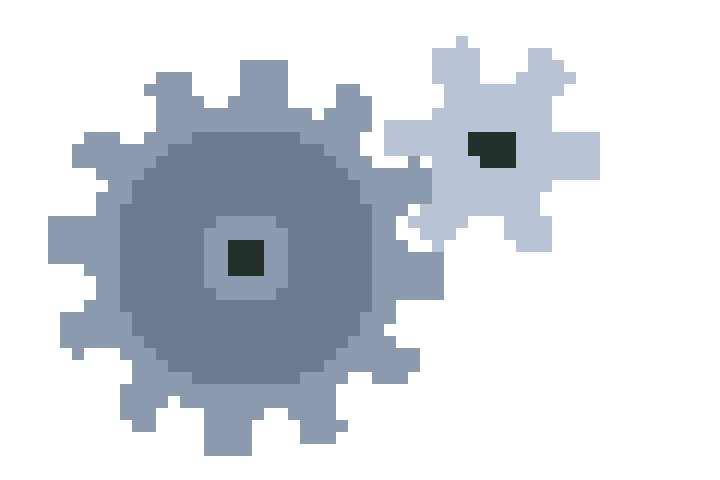

<p align="center">
  
</p>

<h1 align="center">Project Chameleon</h1>

<p align="center">
  <b>Makes an Android phone look like a Linux PC with a graphics card.</b><br>
  Wayland compositors in Termux run on it as they are · full Plasma on KWin · the phone's own GPU · no root
</p>

<p align="center">
  <a href="https://github.com/HarryL0L/Project-Chameleon/actions/workflows/build.yml"></a>
</p>

> [!NOTE]
> **This is the experimental branch.** New work lands here first and is
> tested on real phones before it reaches
> [`main`](https://github.com/HarryL0L/Project-Chameleon/tree/main), so things
> can change or break between commits. `main` has the older state and gets
> these changes when this branch is merged into it.

<p align="center">
  
</p>

---

Linux desktop software expects a kernel with a display, a GPU and input
devices behind standard interfaces: DRM/KMS, GBM, EGL, Vulkan, udev and
evdev. Android has none of those for an app. Chameleon provides them in
Termux, backed by public Android APIs, so the software above needs no
Chameleon-specific code. That goes for any compositor with a DRM backend:
KWin, wlroots compositors such as sway, Weston, Mutter.

- **KWin runs on its normal DRM backend with no Chameleon-specific
  patches**, with a whole Plasma session on top. It is not nested in
  another compositor.
- **The compositor and GPU apps render on the phone's own GPU driver**
  (Mali, Adreno, …), through OpenGL ES and Vulkan.
- **A GPU app's window reaches the compositor without a copy**, as an
  `AHardwareBuffer`. The finished desktop frame then takes one GPU copy on
  its way to Android's display, so the path is not zero-copy end to end.
- **Programs that draw on the CPU work as on any Linux desktop**: `wl_shm`
  windows are uploaded by the compositor, and desktop OpenGL falls back to
  Mesa's software renderer.
- **X11 apps run through Xwayland, which draws on the GPU** when it is
  built with glamor. Vulkan programs get X11 windows too.
- **Input comes back as real devices**: touchscreen or trackpad, mouse,
  hardware keyboards, and the Android on-screen keyboard as the desktop's
  input method.

## What works today

Seen on a Mali-G77 phone on Android 13; the Vulkan items also on an
Adreno 618 on Android 17:

- A full Plasma 6.8 session: start, rotation, the keyboard resizing the
  desktop, 60 and 120 Hz, screen off and on, long stretches in the
  background, logout.
- Qt Quick apps (plasmashell, System Settings) and Firefox on the GPU,
  including WebGL in Firefox.
- Vulkan programs in Wayland windows, on the phone's driver or on a driver
  of your own below Chameleon's (Mesa's Turnip or PanVK built for Android).
- A cursor plane, page flips timed on the panel's vsync, and a render
  node next to the card, as on a PC.
- Typing with the Android keyboard (Gboard, HeliBoard, AOSP), with
  suggestions, emoji and pasted text.
- Clipboard text both ways between Android and the desktop.
- Screen and window recording through KWin's PipeWire screencast, when
  PipeWire runs in the session.

Not there yet: windows of Vulkan drivers other than Chameleon's, and
desktop OpenGL on the GPU without setting it up by hand (Mesa's zink runs
on Chameleon's Vulkan driver, but needs a newer Vulkan below it than many
phones' own drivers have). An
X11 window can flash black while it is being resized. A keyboard's
autocorrection can still double a word in some apps.
GNOME Shell (Mutter), sway and Weston have run on the same device layer
too, but get far less testing than KWin, which every change is tried with
on phones.

## How it works

<p align="center">
  <picture>
    <source media="(prefers-color-scheme: dark)" srcset="branding/architecture-dark.svg">
    
  </picture>
</p>

Only standard interfaces face upward, and one socket protocol faces
downward, to the Chameleon app. Nothing in between knows which compositor
is running.

| Piece | Stands in for | What it does |
|---|---|---|
| `chameleon-kernel` | the kernel | One process per session. Serves the card `/dev/dri/card0` with atomic modesetting, a primary and a cursor plane and vsync-timed page flips; its render node `renderD128`; the evdev input devices; and the link to the app. |
| `libchameleon.so`, `libchameleon_udev.so` | device nodes, udev, sysfs | Preloaded into every program of the session. Opening the card, its ioctls, `/dev/input/event*`, udev listings and hotplug events all behave as on Linux and are answered by `chameleon-kernel`. |
| `libgbm.so` | Mesa's libgbm | Every `gbm_bo` is an `AHardwareBuffer`. Its dma-buf is the one inside the gralloc handle, so the usual gbm → PRIME → framebuffer → EGL import path works unchanged. |
| `libEGL_chameleon.so` | Mesa's EGL driver | A glvnd vendor on Android's `libEGL` and `libGLESv2`. Adds the GBM and Wayland platforms, dma-buf import and export, and the card as an `EGLDevice`. |
| `libvulkan_chameleon.so` | Mesa's Vulkan driver | A driver for the Vulkan loader on Android's `libvulkan`. Names the card's nodes and gives programs Wayland windows. |
| `chameleon-ime` | an on-screen keyboard | The Android keyboard as the compositor's input method (`input-method-v1`). |
| `chameleon-init` | `systemd --user` | The session's first process. Adopts and reaps programs that detach, so none becomes an orphan of Android's init (some phones' process cleaners kill those). |
| The Chameleon app | the monitor and the input hardware | Shows each frame through `ASurfaceControl` and sends touch, mouse, keys, keyboard text, window size and refresh rate back. |

### One frame

<p align="center">
  <picture>
    <source media="(prefers-color-scheme: dark)" srcset="branding/frame-dark.svg">
    
  </picture>
</p>

The compositor's buffer is an `AHardwareBuffer`, and its commit carries the
render fence. The app copies the frame on the GPU into a buffer of its own,
releases the compositor's buffer and queues the copy with
`ASurfaceTransaction`. The page-flip event is stamped from Android's present
fences, so the compositor plans its next frame on the panel's real vsync.
While the app is closed or in the background, simulated flips keep the
session running.

### Starting a session

`chameleon startplasma-wayland` does this, in order:

1. Runs itself below `chameleon-init`, in a D-Bus session.
2. Starts the app's broker and `chameleon-kernel`. The app is an ordinary
   Android app and cannot open Termux's files, so a small broker from its
   APK listens on a socket in Termux and passes connections to the app over
   Binder.
3. Preloads the device layer into the session, puts Chameleon's `libgbm`,
   EGL vendor and Vulkan driver first, and clears `DISPLAY` and
   `WAYLAND_DISPLAY`.
4. Runs the command. With no display variables set, a compositor finds
   `/dev/dri/card0` in udev and picks its DRM backend by itself. Nothing in
   plasma-workspace changes and `--drm` is never passed.

<details>
<summary><b>Display</b>: the card, modes, planes and page flips</summary>

- One connector with an EDID (the phone's physical size, the app's window
  size and the panel's refresh rate as its mode), one CRTC, a primary plane
  and a cursor plane. The cursor is its own Android layer, so moving the
  pointer doesn't redraw the desktop.
- Atomic commits behave as the kernel's do: `TEST_ONLY`, `EBUSY` while a
  flip is pending, fences in and events out. Each open file has its own DRM
  state, released when its last copy closes, even in a process that died.
- The older calls work too, through the same path as the kernel serves
  them: `SETCRTC`, `PAGE_FLIP`, the legacy cursor, `SETPLANE`, DPMS and the
  other properties by `SETPROPERTY`, `ADDFB`/`GETFB`, and waiting for or
  counting vblanks. A program that sets a mode and flips pages the old way
  runs as its own display master.
- Dumb buffers work: memory a program maps through the card and draws into
  on the CPU, without GBM or EGL. The card copies it into a buffer Android
  can show when its framebuffer goes on screen and when `DIRTYFB` says it
  changed. PRIME exports and imports such a buffer too, which is how
  Mesa's software renderer shares its frames with a compositor.
- **Screen size:** rotating the phone, or the keyboard shrinking the
  desktop, changes the connector's mode and sends a hotplug event, exactly
  like a monitor whose modes changed. The compositor re-reads the connector
  and switches. A change of refresh rate (120 to 60 Hz in battery saver) is
  followed the same way.
- **Back from the background:** Android destroys the app's surface while it
  is hidden. The app keeps the last frame and shows it again on return.
- The card and the input devices are compared line by line with a real
  Linux 6.8 kernel (vkms, virtio-gpu, uinput) booted in QEMU, on every
  push.

Code: [`shim/core/`](shim/core/) · protocol: [`common/chameleon_proto.h`](common/chameleon_proto.h)
</details>

<details>
<summary><b>GPU</b>: buffers, OpenGL ES and Vulkan</summary>

- **Buffers:** every GPU buffer of the session is an `AHardwareBuffer`
  with a dma-buf. Any of them can be shared through the card's nodes by
  PRIME, also after the process that made it has gone, as on a real GPU.
- **Wayland apps (EGL):** each `wl_egl_window` renders into an
  `AImageReader`, a real Android window, so the driver's own buffer
  handling applies. Every frame then goes to the compositor as a
  `zwp_linux_dmabuf_v1` buffer, uncopied, paced by frame callbacks.
- **Qt without a rebuild:** Android's driver speaks OpenGL ES only, while
  Termux's Qt is built for desktop OpenGL. Qt already switches to OpenGL ES
  on EGL implementations without desktop GL, and the vendor triggers that
  path, so stock Qt Quick apps (plasmashell, System Settings) render on the
  GPU.
- **Firefox:** finds `libgbm.so.1` and the render node, and shares WebGL
  frames through `EGL_MESA_image_dma_buf_export`.
- **Vulkan:** programs get the phone's driver through Chameleon's, with
  Wayland windows built on Android's own swapchain. With
  `CHAMELEON_VULKAN_DRIVER=/path/driver.so` and Termux's `libadrenotools`
  package, another Android-built driver runs below it instead, which can
  give a phone a newer Vulkan than its own driver has.
- **Driver quirks** are worked around in the EGL vendor, not required of
  the phone: a GLSL construct strict drivers reject, extensions that
  misbehave, context attributes a driver mishandles.
- **Scope:** desktop OpenGL, OpenGL ES in X11 windows and windows under a
  compositor that isn't on Chameleon still go to Mesa.

Code: [`shim/gbm/`](shim/gbm/), [`shim/vendor/`](shim/vendor/), [`shim/egl/`](shim/egl/), [`shim/gles/`](shim/gles/), [`shim/vulkan/`](shim/vulkan/)
</details>

<details>
<summary><b>Input</b>: touch, pointer, keys and the Android keyboard</summary>

- The app sends touch points, trackpad fingers, mouse motion, buttons,
  wheels and hardware keys over the socket. `chameleon-kernel` serves them
  as evdev devices (touchscreen, keyboard, mouse, touchpad, tablet), which
  the compositor's libinput reads like real hardware, so the desktop's
  input settings apply.
- In trackpad mode the whole window is the pad, also where the keyboard
  covers the desktop: tap to click, two-finger tap for the right button,
  two-finger drag to scroll.
- The Android keyboard's text goes to `chameleon-ime` whenever a text field
  has the focus: the word being composed, suggestions, emoji, any language.
  Enter and Backspace arrive as keys. Elsewhere (X11 apps) the text is
  typed as keys of the desktop's layout.
- The package makes `chameleon-ime` KWin's default virtual keyboard; System
  Settings lists it as "Chameleon (Android keyboard)".
- Shortcuts Android keeps for itself, such as Alt+Tab and Meta, need the
  app's optional accessibility service.

Code: [`shim/core/evdev.c`](shim/core/evdev.c), [`shim/core/input.c`](shim/core/input.c), [`shim/core/text.c`](shim/core/text.c), [`shim/ime/`](shim/ime/), [`shim/udev/`](shim/udev/)
</details>

<details>
<summary><b>Clipboard</b>: copy on one side, paste on the other</summary>

- Text copied in a desktop app can be pasted in Android apps and the other
  way round (*Clipboard sharing* in the app's settings, on by default).
- `chameleon-kernel` joins the compositor's clipboard as a clipboard
  manager does, with `ext_data_control_v1`. X11 apps share it through
  Xwayland.
- The text travels through pipes between the desktop app and the Chameleon
  app, never through `chameleon-kernel`.
- Android lets only the app in front read its clipboard, so Android text is
  offered when Chameleon has the focus. Desktop text reaches Android at any
  time.
- Only text is shared. Passwords stay hidden both ways: a desktop password
  manager's copy is marked sensitive on Android, and Android's sensitive
  text stays out of Klipper's history.

Code: [`shim/core/clipboard.c`](shim/core/clipboard.c), [`ClipboardShare.java`](android/app/src/main/java/io/github/harryl0l/chameleon/ClipboardShare.java)
</details>

<details>
<summary><b>When something goes wrong</b>: what Chameleon reports</summary>

- The app's status line says when the desktop's service has stopped
  answering, when the compositor is busy or stuck, and when the session
  still runs but its service is gone.
- The terminal says when the app's window came back and how fast the
  compositor answered, and each program says once when it lost the card.
- A crash in a program that renders with Android's driver logs the last
  GL and EGL calls and a symbolised backtrace.
- Every 5 seconds the service logs how many frames were committed,
  presented and shown on the vsync.

</details>

## What a phone needs

Chameleon uses only public Android APIs and the phone's own GPU driver. No
root and no access to the real `/dev/dri`. Vulkan is optional: without it
everything else works the same.

**System**

| | Needed for |
|---|---|
| arm64 (aarch64), **Android 10** (API 29) or newer | the app (`ASurfaceControl`) and Termux |
| Termux from [GitHub](https://github.com/termux/termux-app/releases) or [F-Droid](https://f-droid.org/packages/com.termux/) | KWin, Plasma and the shim run in it |
| `AHardwareBuffer` (API 26) that can be allocated as RGBA8888 / RGBX8888 with `GPU_SAMPLED_IMAGE \| GPU_COLOR_OUTPUT`, and sent over a Unix socket | every frame: KWin's output and app buffers |
| a dmabuf inside the gralloc handle (`AHardwareBuffer_getNativeHandle`) | buffers are matched across processes by it |
| `AImageReader` from `libmediandk` (API 26) | GPU rendering for Wayland apps; without it apps fall back to Mesa |
| Android sync fences (sync_file) | acquire/release fences between KWin, apps and the app |

**EGL** (1.4 or newer)

| Extension | | Needed for |
|---|---|---|
| `EGL_KHR_image_base`, `EGL_ANDROID_image_native_buffer` | required | `AHardwareBuffer` → `EGLImage` (KWin's buffers, app buffers) |
| `EGL_ANDROID_get_native_client_buffer` | required | the same, from an `AHardwareBuffer` handle |
| `EGL_KHR_no_config_context` | required | KWin refuses to start without it |
| `EGL_KHR_surfaceless_context` | required | KWin refuses to start without it |
| `EGL_ANDROID_native_fence_sync` + `EGL_KHR_wait_sync` | recommended | fences for KWin's commits; without them KWin falls back to `glFinish()` |
| `EGL_KHR_fence_sync` | recommended | sync objects |

**OpenGL ES** (what KWin checks, `EglContext::checkSupported`)

| Requirement | | Needed for |
|---|---|---|
| **OpenGL ES 3.0** or newer (or 2.0 + `GL_OES_texture_3D`) | required | KWin's renderer; 3.2 recommended |
| `GL_OES_EGL_image` (`glEGLImageTargetTexture2DOES`) | required | textures from `EGLImage`s |
| `GL_EXT_unpack_subimage` | required, or OpenGL ES 3.0 | KWin's texture uploads; core in ES 3.0, where Chameleon adds the name KWin asks for (Adreno, PowerVR and newer Mali drivers don't list it) |
| `GL_EXT_read_format_bgra` | required | KWin's screenshots / read-backs |
| `GL_OES_EGL_image_external` | optional | external-only buffer formats |

**Vulkan** (optional)

| Requirement | Needed for |
|---|---|
| A Vulkan driver with `VK_KHR_android_surface` and `VK_KHR_swapchain` | Vulkan programs and their windows |
| `libadrenotools` from Termux, Android 9 or newer | only for a GPU driver of your own below Chameleon's |

Qt, GTK and other apps need nothing beyond this.

Run `chameleon-probe` on the phone to check it. It lists every EGL and
OpenGL ES item above as PASS, FAIL or WARN, renders into an
`AHardwareBuffer`, passes it across a socket and renders an `AImageReader`
frame.

## Getting started

You need Termux (from [GitHub](https://github.com/termux/termux-app/releases)
or [F-Droid](https://f-droid.org/packages/com.termux/)) with KWin installed,
and a phone that meets the list above.

1. Download the `chameleon-<commit>` artifact from the latest
   [Actions run](https://github.com/HarryL0L/Project-Chameleon/actions/workflows/build.yml)
   and unzip it.
2. Install `chameleon.apk` and open **Chameleon**. Uninstall an older
   Chameleon app first if Android refuses the update: builds signed with a
   different key can't replace each other.
3. In Termux, install the package (run `termux-setup-storage` once first, so
   Termux can read `/sdcard`):

   ```sh
   apt install /sdcard/Download/chameleon-*/chameleon_*_aarch64.deb
   ```

4. Start KWin with a terminal, or a full Plasma session:

   ```sh
   chameleon kwin_wayland konsole
   chameleon startplasma-wayland
   ```

5. Switch to the app. Tap the Chameleon icon (drag it anywhere) for its
   buttons: the keyboard, and the settings, where you choose direct touch
   or trackpad, the orientation, and whether the keyboard shrinks the
   desktop or covers it.

Open the app before starting the session, or within 30 seconds: the screen
takes its size from the app's first report.

**Smoothness:** some phones slow down apps that aren't on the maker's game
list. Adding both **Chameleon** and **Termux** there can help.

**A GPU driver of your own:** install Termux's `libadrenotools` and put the
driver's path in front, for one program or a whole session:

```sh
CHAMELEON_VULKAN_DRIVER=$HOME/drivers/turnip.so chameleon startplasma-wayland
```

The driver must be an Android build (the kind emulators load), not a Linux
one. If it can't be loaded, Chameleon says why and uses the phone's driver.

More switches and the details of each piece are in
[`shim/README.md`](shim/README.md).

## Repository layout

| Path | What |
|---|---|
| [`android/`](android/) | The Chameleon app: presenter (C++, `ASurfaceControl`), input, settings |
| [`common/`](common/) | Socket protocol shared by both sides |
| [`shim/core/`](shim/core/) | `chameleon-kernel`: fake KMS device, presenter link, input, screen size, clipboard, apps' GPU buffers; `libchameleon.so`: the card node, crash reporter |
| [`shim/udev/`](shim/udev/) | `libchameleon_udev.so`: udev, the sysfs entries and the `/dev/input` nodes of Chameleon's devices |
| [`shim/ime/`](shim/ime/) | `chameleon-ime`: the Android keyboard as the compositor's input method |
| [`shim/init/`](shim/init/) | `chameleon-init`: the session's init, adopts and reaps the programs that detach in it |
| [`shim/gbm/`](shim/gbm/) | Fake `libgbm.so` on `AHardwareBuffer` |
| [`shim/vendor/`](shim/vendor/), [`shim/egl/`](shim/egl/), [`shim/gles/`](shim/gles/) | `libEGL_chameleon.so`, the glvnd EGL vendor; `vendor/window.c`: an app's window, for EGL and Vulkan |
| [`shim/vulkan/`](shim/vulkan/) | `libvulkan_chameleon.so`, the card's Vulkan driver on Android's, with Wayland windows |
| [`shim/chameleon`](shim/chameleon), [`shim/chameleon-vendor-install`](shim/chameleon-vendor-install) | Launchers |
| [`shim/test/`](shim/test/) | Host tests: fake KMS with real libdrm, input and screen size with real libwayland, vendor with real glvnd, Vulkan with the real loader on lavapipe; conformance tests against a real Linux kernel in QEMU |
| [`probe/`](probe/) | `ahb_probe`: checks a device's EGL / AHardwareBuffer / fence support |
| [`docs/`](docs/) | Design notes ([KWin integration](docs/kwin-integration.md)) |
| [`packaging/`](packaging/) | Termux `.deb` packaging |
| [`branding/`](branding/) | Logo and launcher-icon generator |

## Building

Everything builds on GitHub Actions ([`build.yml`](.github/workflows/build.yml)).
Each push produces one artifact with the APK and the Termux package, and
runs the host tests and the conformance tests.

Locally:

```sh
gradle -p android assembleRelease                                     # the app
CC=$NDK/toolchains/llvm/prebuilt/linux-x86_64/bin/aarch64-linux-android29-clang \
    shim/build-android.sh out/chameleon                               # the shim
packaging/build-deb.sh out/chameleon out/ahb_probe 0.1.0 out/         # the Termux package
shim/test/run-host-test.sh     # host tests
shim/test/run-conformance.sh   # against a real kernel in QEMU
```

The host tests need `libdrm-dev libwayland-dev libegl-dev libgles-dev
libudev-dev libinput-dev libvulkan-dev mesa-vulkan-drivers
vulkan-validationlayers vulkan-tools`; the conformance tests also need
`qemu-system-x86 busybox-static cpio zstd`.

## Roadmap

- [x] KWin without Chameleon patches on a KMS card served by a per-session kernel service
- [x] OpenGL ES for the compositor and Wayland apps on the phone's driver
- [x] Touch, trackpad, mouse, keyboards and the Android keyboard
- [x] Screen resize, rotation and refresh-rate changes
- [x] Clipboard sharing with Android
- [x] Render node and buffer sharing between any programs of the session
- [x] Firefox acceleration
- [x] Cursor plane and vsync-timed page flips
- [x] Screen recording through PipeWire
- [x] Vulkan with Wayland windows, on the phone's driver or your own
- [x] Vulkan for X11 windows, and GPU rendering in Xwayland (glamor)
- [ ] Windows of any other GPU driver
- [ ] A release

## Notes

- Not affiliated with KDE, Termux or Google. The "W" disc in the logo is a
  stylised nod to Wayland, not the official Wayland logo.
- Licence: GPL-2.0-or-later, like KWin, whose process `libchameleon.so`
  runs in. Each source file says so (`SPDX-License-Identifier`), and
  [LICENSE](LICENSE) holds the GPL version 2 text.
- `shim/include/` holds unmodified headers from libdrm, Mesa (`gbm.h`),
  libglvnd and Khronos (Vulkan), which keep their own licences
  ([sources and versions](shim/include/README.md)).
